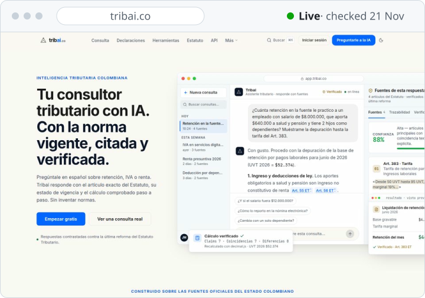

# Cristian Espinal Maya

**I build AI for work where a wrong answer has consequences: tax, law and public administration in Latin America.** Three products are in production. Each one answers with its source, so a professional can check it before signing.

Partner & CTO at [INPLUX](https://inplux.co) · Partner at [TENSOR](https://tensor.lat) · Economist · PhD candidate in Engineering, Universidad Nacional de Colombia · Medellín

[cespial.co](https://cespial.co/en) · [LinkedIn](https://www.linkedin.com/in/cespial/) · [ORCID](https://orcid.org/0009-0000-1009-8388) · [Get in touch](https://cespial.co/en#contacto)

## In production

<a href="https://tribai.co"><picture><source media="(prefers-color-scheme: dark)" srcset="https://raw.githubusercontent.com/Cespial/Cespial/stats/product-tribai-dark.svg"></picture></a>

### Tribai

Tax answers for Colombia. Each one comes with the exact article of the tax code, whether that article is still in force, and a calculation that has been checked.

**40 calculators · 1,301 articles of the tax code**

[tribai.co](https://tribai.co)

  

<a href="https://kelsen.io"><picture><source media="(prefers-color-scheme: dark)" srcset="https://raw.githubusercontent.com/Cespial/Cespial/stats/product-kelsen-dark.svg"></picture></a>

### Kelsen

Legal research and document analysis over Colombian law. Every answer can be traced to the ruling or the statute it rests on.

**970K+ documents · 28K+ rulings · 7.0M indexed passages**

[kelsen.io](https://kelsen.io)

  

<a href="https://gobia.co"><picture><source media="(prefers-color-scheme: dark)" srcset="https://raw.githubusercontent.com/Cespial/Cespial/stats/product-gobia-dark.svg"></picture></a>

### Gobia

For municipalities and departments in Colombia. It joins fiscal data, targets and regulation, so that scattered records become decisions with a trail.

[gobia.co](https://gobia.co)

  

## How it gets built

<picture>
  <source media="(prefers-color-scheme: dark)" srcset="https://raw.githubusercontent.com/Cespial/Cespial/stats/record-dark.svg">
  
</picture>

I work with coding agents running in parallel, mostly Claude Code. I choose the problem, design the system and review what ships; the agents write the code. The record starts in February 2026. Most of it is product and client work, so it sits in private repositories and only the totals appear here.

## Research

I also measure what this technology does to work.

- **The Delegation Divide** (with Santiago Jiménez Londoño). An open, preregistered index of how much work AI agents can take over. Across 146 countries, 35.2% of task time in employment is at least partly delegable. [arXiv:2610.30752](https://arxiv.org/abs/2610.30752) · [index](https://balamlabs.org/adi) · [code](https://github.com/Cespial/delegation-divide)
- **Augmented Human Capital.** A theory of which parts of a job AI augments, and a way to measure them with language models. [arXiv:2604.01066](https://arxiv.org/abs/2604.01066) · [code](https://github.com/Cespial/cognitive-factor-economics)
- **Flood Risk Mapping in Antioquia** (with Santiago Jiménez Londoño). Satellite radar and machine learning to map flood risk municipality by municipality. [SSRN 6321538](https://doi.org/10.2139/ssrn.6321538) · [code](https://github.com/Cespial/colombia-flood-risk)

## Clients and teaching

- Through INPLUX and TENSOR, 23 public and private organizations, among them Corantioquia, Universidad de Antioquia, Universidad de Medellín and Terminales de Transporte de Medellín. [Full list](https://cespial.co/en#experiencia)
- I teach AI to leadership teams at NODO EAFIT and to graduate students at ESUMER.
- Before INPLUX, I led AI and automation at PRGX LATAM and designed services at the Medellín Chamber of Commerce.

## Open work

- [porcelain-ui](https://github.com/Cespial/porcelain-ui): the skills my agents use to collect references, build interfaces and review them against a quality bar.
- [propuestas-secop](https://github.com/Cespial/propuestas-secop): a Claude Code plugin that takes a Colombian public tender from the go/no-go decision to the final package.
- [cartografia-colombia](https://github.com/Cespial/cartografia-colombia): a map of the cadastral status of Colombia's 1,122 municipalities. [Live](https://cartografia-colombia.vercel.app)
- [night-lights-disaster-disruption](https://github.com/Cespial/night-lights-disaster-disruption): replication package for a study of when satellite night lights measure the disruption a disaster causes.

The rest is in [PROJECTS.md](PROJECTS.md).

## Contact

If you invest in AI for Latin America, or build it, write to me. I will be in San Francisco the week of December 7, 2026.

[Get in touch](https://cespial.co/en#contacto) · [LinkedIn](https://www.linkedin.com/in/cespial/)

The screenshots and the record are rebuilt every day by [the scripts in this repository](scripts), from the live sites and the GitHub API. A product shows as live only on a day its site answered. Exact numbers: [stats.json](https://github.com/Cespial/Cespial/blob/stats/stats.json).
