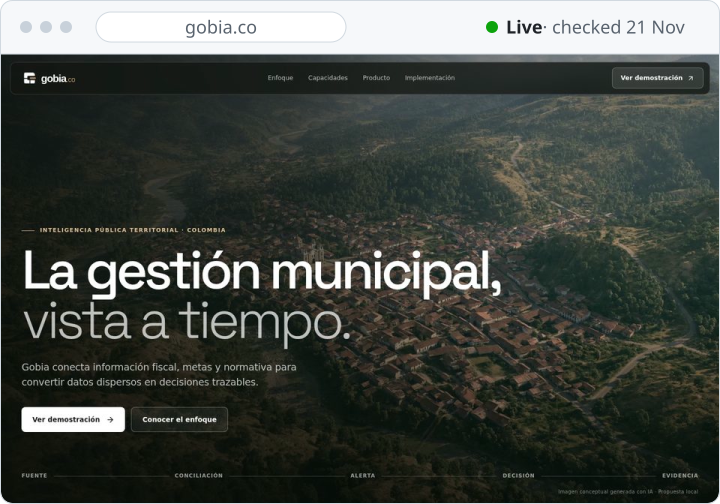

<picture>
  <source media="(prefers-color-scheme: dark)" srcset="https://raw.githubusercontent.com/Cespial/Cespial/stats/wave-dark.svg">
  
</picture>

# Cristian Espinal Maya

**One builder, a fleet of AI agents.** I ship AI products for tax, law and government in Latin America, at the pace of a team.

Partner & CTO at [INPLUX](https://inplux.co) · Partner at [TENSOR](https://tensor.lat) · Economist · PhD candidate in Engineering, Universidad Nacional de Colombia · Medellín

[cespial.co](https://cespial.co/en) · [LinkedIn](https://www.linkedin.com/in/cespial/) · [ORCID](https://orcid.org/0009-0000-1009-8388) · [Get in touch](https://cespial.co/en#contacto)

<picture>
  <source media="(prefers-color-scheme: dark)" srcset="https://raw.githubusercontent.com/Cespial/Cespial/stats/pulse-dark.svg">
  
</picture>

## In production

<a href="https://tribai.co"><picture><source media="(prefers-color-scheme: dark)" srcset="https://raw.githubusercontent.com/Cespial/Cespial/stats/product-tribai-dark.svg"></picture></a>

### Tribai

AI tax consultant for Colombia. It answers with the exact article of the tax code, whether that article is in force, and a verified calculation.

**40 calculators · 1,301 articles**

[tribai.co](https://tribai.co)

 

<a href="https://kelsen.io"><picture><source media="(prefers-color-scheme: dark)" srcset="https://raw.githubusercontent.com/Cespial/Cespial/stats/product-kelsen-dark.svg"></picture></a>

### Kelsen

Legal AI for Colombia: research, document analysis and assistance over the country's body of law, verifiable down to the source.

**970K+ documents · 28K+ rulings · 7.0M indexed passages**

[kelsen.io](https://kelsen.io)

 

<a href="https://gobia.co"><picture><source media="(prefers-color-scheme: dark)" srcset="https://raw.githubusercontent.com/Cespial/Cespial/stats/product-gobia-dark.svg"></picture></a>

### Gobia

GovTech platform for Colombian municipalities and departments. It connects fiscal data, targets and regulation so that public managers can decide on time and leave a trace.

**AI · open data · regulatory automation**

[gobia.co](https://gobia.co)

 

## How I work

I build with coding agents running in parallel, mostly Claude Code. I choose the problem, design the system and review what ships; the agents do the typing. Activity here starts in February 2026. Most of it is client and product work, so it lives in private repositories.

## Track record

- **23 public and private organizations** served through INPLUX and TENSOR, among them Corantioquia, Universidad de Antioquia, Universidad de Medellín and Terminales de Transporte de Medellín. [Full list](https://cespial.co/en#experiencia)
- **Teaching:** AI for leadership teams at NODO EAFIT and graduate courses at ESUMER.
- **Before:** AI & Automation Lead at PRGX LATAM, and service architect at the Medellín Chamber of Commerce.

## Research

- **The Delegation Divide** (with Santiago Jiménez Londoño). An open, preregistered index of how much work AI agents can take over: 18,796 task statements, 433 occupations, 146 countries. [arXiv:2610.30752](https://arxiv.org/abs/2610.30752) · [index](https://balamlabs.org/adi) · [code](https://github.com/Cespial/delegation-divide)
- **Augmented Human Capital.** A unified theory and an LLM-based way to measure which parts of a job AI augments. [arXiv:2604.01066](https://arxiv.org/abs/2604.01066) · [code](https://github.com/Cespial/cognitive-factor-economics)
- **Flood Risk Mapping in Antioquia** (with Santiago Jiménez Londoño). Sentinel-1 radar and ensemble machine learning at municipal scale. [SSRN 6321538](https://doi.org/10.2139/ssrn.6321538) · [code](https://github.com/Cespial/colombia-flood-risk)

## Open source

- [porcelain-ui](https://github.com/Cespial/porcelain-ui): agent skills for harvesting references, building and reviewing production UI.
- [propuestas-secop](https://github.com/Cespial/propuestas-secop): Claude Code plugin that runs a public procurement bid in Colombia phase by phase, from the go/no-go gate to the red team.
- [tensor-atlas](https://github.com/Cespial/tensor-atlas): Claude Code plugin with the skills to build a territorial atlas step by step.
- [cartografia-colombia](https://github.com/Cespial/cartografia-colombia): interactive map of the cadastral status of Colombia's 1,122 municipalities. [Live](https://cartografia-colombia.vercel.app)
- [night-lights-disaster-disruption](https://github.com/Cespial/night-lights-disaster-disruption): replication package on when satellite night lights measure disaster disruption.
- [amparo](https://github.com/Cespial/amparo): online dispute resolution for health-care injunctions in Colombia, built at the ODR 2026 hackathon at Suffolk.

<picture>
  <source media="(prefers-color-scheme: dark)" srcset="https://raw.githubusercontent.com/Cespial/Cespial/stats/stack-dark.svg">
  
</picture>

Everything else, including observatories, consulting work and earlier papers, is in [PROJECTS.md](PROJECTS.md).

## Let's talk

If you invest in or build AI for Latin America, I'd like to talk. I'll be in San Francisco the week of December 7, 2026.

[Get in touch](https://cespial.co/en#contacto) · [LinkedIn](https://www.linkedin.com/in/cespial/)

Every chart and screenshot on this page is rebuilt daily by [scripts in this repo](scripts), straight from the GitHub API and the live sites, with no third-party widgets. A product only shows as live on a day its site answered. Exact numbers: [stats.json](https://github.com/Cespial/Cespial/blob/stats/stats.json).
